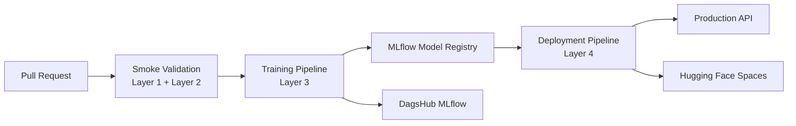

# Atlas AI Platform

> **Atlas is an AI infrastructure reference implementation: a senior-engineering approach to reproducible training, verifiable model quality and controlled delivery.**

[](../../actions/workflows/smoke.yml)
[](../../actions/workflows/train.yml)
[](../../actions/workflows/deploy.yml)


---

Architecture • Validation • CI/CD • MLflow • IaC • Deployment

## Why Atlas?

Most machine learning repositories focus on training a model.

Atlas focuses on everything **around** the model.

The goal is not to demonstrate state-of-the-art machine learning.

The goal is to demonstrate how production AI systems can be engineered using reproducible workflows, validation gates, infrastructure as code, model lifecycle management, and automated deployment.

The included **UCI Adult Income** dataset is intentionally lightweight so the focus remains on engineering the platform rather than optimizing the model.

Atlas is a focused engineering reference implementation. It separates checks
that run in credential-free CI from optional cloud and hosted stages, so a green
local pipeline is never presented as proof of a hosted deployment.

Current evidence: [Smoke CI](https://github.com/daytona675r/atlas-ai-platform/actions/runs/40929514856)
and [Portfolio Acceptance](https://github.com/daytona675r/atlas-ai-platform/actions/runs/40929514389)
are green on the current main branch. A confirmed Hugging Face hosted run and
public endpoint are still pending owner configuration and issue #4.

---

# Architecture



Atlas demonstrates an end-to-end production workflow:

```
Code
    ↓
Validation
    ↓
Training
    ↓
Model Registry
    ↓
Deployment
    ↓
Production Validation
```

---

# Key Capabilities

## Production-oriented MLOps

- Reproducible model training
- MLflow model lifecycle
- Controlled model promotion
- Versioned experiments
- Model lineage

## Four Validation Layers

Rather than validating only model performance, Atlas validates the entire engineering workflow.

### Layer 1 — Data Validation

Ensures datasets are complete, reproducible and structurally correct before training begins.

### Layer 2 — Engineering Validation

Validates code quality, Docker builds, unit tests, smoke training and MLflow connectivity.

### Layer 3 — Model Validation

Evaluates training quality, reproducibility, overfitting safeguards and champion comparison before model registration.

### Layer 4 — Deployment Validation

Verifies the deployed application through health checks, inference tests, schema validation and production readiness.

The four layers describe the intended control plane. The repository currently
enforces data/engineering checks, model validation and local serving checks;
hosted HF verification and production alias promotion remain gated by the
configured deployment workflow.

---

# Technology Stack

| Area | Technology |
|-------|------------|
| ML | scikit-learn |
| Experiment Tracking | MLflow (DagsHub) |
| CI/CD | GitHub Actions |
| Infrastructure | Terraform (HCP) |
| Containers | Docker |
| Backend | FastAPI |
| Deployment | Hugging Face Spaces |
| Cloud | AWS (optional) |

---

# Repository Structure

```
src/
configs/
docker/
infra/
.github/
docs/
tests/
```

---

# Quick Start

Clone the repository

```bash
git clone https://github.com/daytona675r/atlas-ai-platform.git
```

Install

```bash
pip install -e ".[dev]"
```

Run a smoke validation

```bash
make validate-data-smoke
```

Run smoke training

```bash
MLFLOW_DISABLED=1 make train-smoke
```

Run tests

```bash
make test
```

---

# Design Principles

Atlas is built around a few engineering principles.

- Build platforms, not scripts.
- Treat AI systems like software systems.
- Validation before deployment.
- Reproducibility by design.
- Infrastructure as Code.
- Automation over manual processes.

---

# Documentation

- [System specification](docs/MLOPS_SYSTEM_SPEC.md)
- [Credentials and OIDC runbook](docs/CREDENTIALS.md)
- [Terraform infrastructure](infra/terraform/README.md)

---

# Why this project exists

This repository is intentionally designed as a production-oriented reference implementation rather than an academic machine learning project.

It demonstrates how experienced software engineering practices can be applied to modern AI systems using reproducible workflows, automated validation, infrastructure as code and controlled deployment.

The emphasis is not on achieving the highest model accuracy.

The emphasis is on building AI systems that can be trusted in production.

## Continuous deployment

`.github/workflows/deploy.yml` provides the Docker-based Hugging Face Space
staging path. A successful full-train run hands off its exact `model.pkl` and
immutable candidate metadata to the deployment workflow; the workflow verifies
the local serving contract, pushes the same artifact to the configured Space,
waits for hosted health and runs the Layer-4 inference/golden checks. Configure
the repository variables `HF_SPACE_REPO` and `HF_SPACE_URL` plus secret
`HF_TOKEN` before enabling the hosted stage. `HF_SPACE_URL` must be the actual
`https://<space>.hf.space` runtime URL; the workflow never guesses it from the
repository name. Manual dispatch also requires the exact successful Full Train
run ID containing the candidate artifact. Without these values, the workflow
records an explicit skipped state instead of pretending that deployment
occurred. Production alias promotion remains a protected, manual MLflow
operation after hosted verification.
